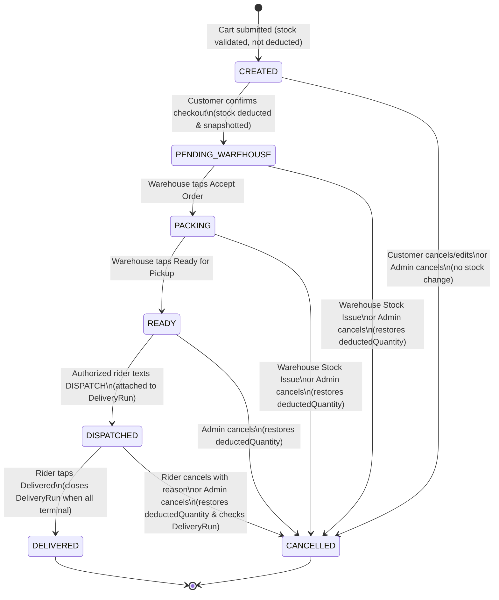
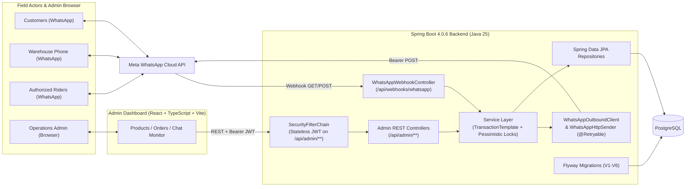

# GreenGram

**A WhatsApp-first local commerce and hyperlocal delivery platform.**

GreenGram enables local grocery and essentials businesses to receive catalog orders, validate delivery radii, manage shared bulk inventory, coordinate warehouse packing, and dispatch riders—entirely through native WhatsApp interactions—backed by a Spring Boot API, PostgreSQL database, and a React Admin Dashboard.

---

## Table of Contents

- [Project Overview](#project-overview)
- [Key Features](#key-features)
- [Customer-to-Delivery Workflow](#customer-to-delivery-workflow)
- [Order Lifecycle](#order-lifecycle)
- [System Architecture](#system-architecture)
- [Engineering Highlights](#engineering-highlights)
- [Technology Stack](#technology-stack)
- [Project Structure](#project-structure)
- [Getting Started](#getting-started)
  - [Prerequisites](#prerequisites)
  - [Database Configuration and Migrations](#database-configuration-and-migrations)
  - [WhatsApp Cloud API Configuration](#whatsapp-cloud-api-configuration)
  - [Backend Startup Instructions](#backend-startup-instructions)
  - [Frontend Startup Instructions](#frontend-startup-instructions)
  - [Automated Testing Instructions](#automated-testing-instructions)
- [Security and Reliability Considerations](#security-and-reliability-considerations)
- [Project Roadmap](#project-roadmap)
- [Contributing & License](#contributing--license)

---

## Project Overview

Local grocery stores, spice mills, and neighborhood commerce operators face high friction when forcing customers to install and register on standalone mobile apps. At the same time, taking orders manually over informal chat messages breaks down quickly: stock counts drift across package sizes, orders are missed during peak hours, delivery locations are ambiguous, and rider handoffs lack structure.

GreenGram solves this by turning **WhatsApp** into the complete operational interface for all three field actors—**customers**, **warehouse packers**, and **delivery riders**—while enforcing transactional integrity on the backend:

- **Zero-app customer experience:** Customers browse the Meta Commerce catalog, submit carts, confirm orders, and share GPS location pins inside WhatsApp.
- **Shared physical inventory pools:** Multiple retail SKUs (e.g., `500G` and `1KG` packs) draw from a single physical `Inventory` pool (`NUMERIC(38, 3)` in `KG`, `L`, `PCS`, or `PACK`) under pessimistic row locks.
- **Structured fulfillment & dispatch:** Warehouse staff accept, pack, and mark orders ready via interactive WhatsApp buttons; authorized riders pull `READY` batches into tracked `DeliveryRun` manifests using a text command (`DISPATCH`).
- **Centralized back-office control:** Operations staff manage product variants, physical stock pools, order monitoring, and customer WhatsApp conversation logs through a JWT-protected React + TypeScript Admin Dashboard.

---

## Key Features

### Customer WhatsApp Ordering
- Interactive catalog launch (`catalog_message`) triggered when a customer messages the business number.
- Supports both standard WhatsApp phone numbers and Meta Business-Scoped User IDs (`bsuid`), separating database identity (`bsuid` / `whatsapp_number`) from outbound routing (`recipientId`).
- Delivery promise messaging dynamically adapts to the `Asia/Kolkata` 18:30 cutoff (`today evening` vs. `tomorrow evening`).

### Product Catalogue Integration
- Processes inbound Meta `order` cart payloads containing `product_retailer_id` (SKU) and quantities.
- Validates product active flags (`isActive`) and stock feasibility before creating a `CREATED` order shell with price snapshots (`OrderItem.lockedPrice`).
- **Independent location & radius bounding:** After checkout confirmation, if an order has no coordinates yet, the customer is prompted to reuse a saved location (`REUSE_LOC_`) or drop a GPS pin (`LOCATION`, with multi-order disambiguation via `SETLOC_` / `SETLOC_ALL_`). Dropped pins are validated against `store.latitude`, `store.longitude`, and `store.max.radius.km` (`DistanceUtil`). Out-of-range pins are rejected with a WhatsApp message and coordinates are not saved, though this validation runs independently and does not block warehouse acceptance or packing.

### Order Confirmation and Cancellation
- **Deferred stock deduction:** Submitting a cart creates a `CREATED` order without deducting stock, preventing abandoned carts from locking inventory. Stock is deducted atomically only when the customer confirms checkout (`finalizeOrderCheckout`), storing `OrderItem.deductedQuantity`.
- **Multi-actor cancellation (`CancellationActor`):** Enforces role-specific state rules for `CUSTOMER`, `WAREHOUSE`, `RIDER`, and `ADMIN` cancellations. Confirmed orders restore exact snapshotted `deductedQuantity` values back to their `Inventory` pools under deadlock-free lock ordering; legacy un-snapshotted items flag `stockReconciled = false` and `stockReconciliationRequired = true` instead of guessing restoration amounts.

### Inventory Management
- Dedicated `AdminInventoryController` and `ProductAdminService` endpoints for listing inventory pools, creating pools, and applying positive/negative stock adjustments (`PUT /api/admin/inventories/{id}/stock`).
- Rejects adjustments that would drive stock below zero and writes atomic entries to `inventory_audit_logs` (`old_stock`, `new_stock`, `change_amount`, `reason`, `changed_by`, `timestamp`).
- Triggers automated low-stock WhatsApp alerts to the warehouse when pool stock falls to or below `DeliveryConstants.LOW_STOCK_THRESHOLD` (`5`).

### Shared Inventory Pools
- Decouples customer-facing SKU variants (`products`) from physical stock (`inventories`) via `V2__introduce_shared_inventory.sql`.
- Converts package quantities across compatible units (`G` ↔ `KG`, `ML` ↔ `L`, and identical units such as `PCS` or `PACK`) using deterministic `BigDecimal` arithmetic (`UnitConverter`, scale 3, `RoundingMode.HALF_UP`).
- Acquires `PESSIMISTIC_WRITE` locks sorted by `Inventory.id` ascending to prevent deadlocks during concurrent multi-item checkouts and cancellations.

### Warehouse Operations
- Sends interactive **New Order Alerts** (`Accept Order` / `Stock Issue`) to the configured `warehouse.phone.number`.
- Supports an interactive pending-orders inbox list (up to 10 pending rows per list message) when the warehouse number messages the bot.
- Guides packers from `PENDING_WAREHOUSE` → `PACKING` → `READY` (with `readyAt` timestamp) via interactive reply buttons.

### Delivery Management
- Pull-based batch dispatch: an authorized rider (verified against `authorized.rider.numbers`) sends `DISPATCH` via WhatsApp.
- `BatchingService` locks eligible `READY` orders in ascending ID order, creates an `IN_PROGRESS` `DeliveryRun`, transitions orders to `DISPATCHED`, sends a consolidated cash-collection manifest to the rider, notifies each customer with an out-for-delivery alert, and sends per-order interactive **Delivery Cards** (`Mark Delivered` / `Cannot Deliver` with reason selection).
- Automatically marks a `DeliveryRun` as `COMPLETED` once all orders in the run reach `DELIVERED` or `CANCELLED`.

### Admin Dashboard
- React + TypeScript + Vite single-page application in `admin-dashboard/`.
- Authenticated via `POST /api/admin/auth/login` with JWT stored in `sessionStorage`.
- **Products & Inventory view:** Browse products and linked inventory pools, create new products (linking to an existing pool or creating a new pool with unit-compatibility validation), edit prices, toggle active status, and adjust pool stock with audit reasons.
- **Orders view:** Storewide today KPI summary cards (in `Asia/Kolkata`), paginated/sortable order table, search, multi-status filters, date presets (`TODAY`, `YESTERDAY`, `LAST_7_DAYS`, `LAST_30_DAYS`, `ALL_TIME`, `CUSTOM` up to 90 days), `hasLocation` / `needsAttention` filters, and an order detail modal displaying customer info, Google Maps link, delivery run details, item price/deduction snapshots, and milestone timeline.

### WhatsApp Chat Monitor
- Persists inbound and outbound WhatsApp interactions in `whatsapp_message_logs` using isolated `REQUIRES_NEW` transactions (`WhatsAppLoggingService`) with `external_message_id` deduplication.
- Redacts raw GPS coordinates from logged location messages and normalizes Meta profile names (`V6`).
- **Chat Monitor tab** in the Admin Dashboard lists active conversations ordered by latest activity, highlights customers with active orders awaiting a delivery location, displays normalized profile names alongside phone numbers/BSUIDs, supports search filtering, and loads chronological conversation histories.

---

## Customer-to-Delivery Workflow

1. **Browse & Cart Submission:** Customer texts the bot (`catalog_message` reply) and submits a Meta catalog cart (`ORDER`), creating a `CREATED` order shell with locked item prices.
2. **Checkout Confirmation & Concurrent Notifications:** When the customer taps **Confirm Order**, `OrderService.finalizeOrderCheckout` atomically deducts inventory, snapshots `deductedQuantity`, and moves the order to `PENDING_WAREHOUSE`. Post-commit, two independent flows start immediately:
   - **Warehouse alert:** The `warehouse.phone.number` receives an interactive **New Order Alert** (**Accept Order** / **Stock Issue**) right away.
   - **Delivery location prompt:** If the order lacks coordinates, the customer receives a confirmation message asking them to reuse a saved address or share a GPS pin. Location validation against `store.max.radius.km` runs independently; out-of-range pins are rejected with a customer notice and leave order coordinates unset, without blocking warehouse packing or dispatch (missing locations are flagged to admins and riders).
3. **Packing & Batch Dispatch:** Warehouse staff move the order through `PACKING` → `READY`. Authorized riders text `DISPATCH` to pull all `READY` orders into an `IN_PROGRESS` `DeliveryRun`, receiving a cash-collection manifest and per-order Delivery Cards until all orders reach `DELIVERED` or `CANCELLED`.

```mermaid
sequenceDiagram
    autonumber
    actor Customer
    actor Warehouse as Warehouse Phone
    actor Rider as Authorized Rider
    participant Meta as Meta WhatsApp Cloud API
    participant Backend as GreenGram Backend
    participant DB as PostgreSQL

    Customer->>Meta: Texts bot ("Hi")
    Meta->>Backend: POST /api/webhooks/whatsapp
    Backend->>Meta: Interactive catalog_message

    Customer->>Meta: Submits catalog cart (ORDER)
    Meta->>Backend: POST /api/webhooks/whatsapp
    Backend->>DB: Save CREATED order (stock validated, not deducted)
    Backend->>Meta: Order summary (Confirm / Edit / Cancel)

    Customer->>Meta: Taps Confirm Order
    Meta->>Backend: POST /api/webhooks/whatsapp
    Backend->>DB: Deduct Inventory + set PENDING_WAREHOUSE

    par Warehouse Packing Flow (non-blocking)
        Backend->>Meta: New Order Alert (Accept / Stock Issue)
        Meta->>Warehouse: Interactive alert
        Warehouse->>Meta: Taps Accept Order -> Ready for Pickup
        Meta->>Backend: POST /api/webhooks/whatsapp
        Backend->>DB: PENDING_WAREHOUSE -> PACKING -> READY
    and Independent Customer Location Flow
        Backend->>Meta: Confirmation + Location prompt (if unset)
        Meta->>Customer: Reuse Saved Location or Share Pin
        Customer->>Meta: Shares pin / confirms saved location
        Meta->>Backend: POST /api/webhooks/whatsapp
        Backend->>DB: Validate radius (store.max.radius.km); save if in range
    end

    Rider->>Meta: Texts "DISPATCH"
    Meta->>Backend: POST /api/webhooks/whatsapp
    Backend->>DB: Lock READY orders -> DeliveryRun (IN_PROGRESS), DISPATCHED
    Backend->>Meta: Manifest + Delivery Cards to Rider; ETA alert to Customer

    Rider->>Meta: Taps Delivered
    Meta->>Backend: POST /api/webhooks/whatsapp
    Backend->>DB: Set DELIVERED; complete DeliveryRun if all terminal
    Backend->>Meta: Delivery confirmation to Customer
```

---

## Order Lifecycle

Order state transitions are enforced inside `CustomerOrder.advanceStateTo(OrderStatus)` and actor-guarded inside `OrderService.cancelOrder(...)` and `OrderService.editOrder(...)`:



---

## System Architecture



---

## Engineering Highlights

| Design Decision | Problem Addressed | Implementation in GreenGram |
|---|---|---|
| **Shared Inventory Pools** | Variant-level stock causes drift when multiple retail packs (e.g., `500G` and `1KG`) sell from the same bulk stock. | `V2` separates `products` (variants) from `inventories` (`NUMERIC(38, 3)` physical pools). `UnitConverter` converts `G`↔`KG` and `ML`↔`L` with `BigDecimal` scale 3 (`HALF_UP`). |
| **Deferred Deduction & Snapshots** | Deducting stock at cart creation lets abandoned carts freeze inventory; restoring stock from current product metadata fails if package sizes change later. | `processNewCart` validates stock without deducting; `finalizeOrderCheckout` deducts stock atomically and records `OrderItem.deductedQuantity` (`V4`). Cancellations restore exact snapshots or flag `stockReconciled = false`. |
| **Pessimistic Locking & Lock Ordering** | Concurrent checkouts and cancellations across overlapping shared pools risk overselling and AB-BA deadlocks. | Repositories use `PESSIMISTIC_WRITE` (`findByIdForUpdate`). Multi-inventory checkouts, cancellations, and batch dispatches acquire locks in deterministic ascending ID order. |
| **Explicit Transaction Boundaries** | Issuing Meta Graph API HTTP calls inside `@Transactional` holds PostgreSQL row locks and pool connections during network latency or retries. | `OrderService`, `WarehouseService`, and `BatchingService` use `Propagation.NOT_SUPPORTED` with `TransactionTemplate` so DB commits finish before outbound HTTP calls; `WhatsAppLoggingService` uses `REQUIRES_NEW` to isolate log failures. |
| **Idempotent State & Log Guards** | Duplicate button taps or Meta webhook redeliveries can double-deduct stock, double-restore stock, or insert duplicate chat logs. | `whatsapp_message_logs.external_message_id` enforces uniqueness (`V3`) with pre-insert checks; `finalizeOrderCheckout`, `cancelOrder`, `completeDelivery`, and location-assignment methods guard against non-eligible states under row locks. |
| **Stateless JWT Admin Auth** | Separating public webhook endpoints from back-office operations without server-side session storage. | `SecurityConfig` permits `/api/webhooks/**` and `/api/admin/auth/login`, validates HMAC-SHA256 (`X-Hub-Signature-256`) on webhook POSTs, requires JJWT Bearer tokens on `/api/admin/**`, scopes CORS to admin routes, and sets `anyRequest().denyAll()`. |
| **Flyway Schema Migrations** | Evolving production PostgreSQL schemas safely without Hibernate auto-DDL surprises. | Versioned Flyway scripts (`V1`–`V6`) manage sequences, tables, constraints, and data backfills alongside `spring.jpa.hibernate.ddl-auto=validate`. |
| **Multi-Actor Cancellation & Reconciliation** | Different actors cancel at different fulfillment stages, with different stock and delivery-run side effects. | `CancellationActor` restricts `CUSTOMER` (`CREATED`), `WAREHOUSE` (`PENDING_WAREHOUSE`/`PACKING`), `RIDER` (`DISPATCHED`), and `ADMIN` (any non-terminal), restoring stock only post-`CREATED` and closing `DeliveryRun`s when all orders are terminal. |

---

## Technology Stack

All versions below are verified directly from [pom.xml](pom.xml), [Dockerfile](Dockerfile), [.mvn/wrapper/maven-wrapper.properties](.mvn/wrapper/maven-wrapper.properties), and [admin-dashboard/package.json](admin-dashboard/package.json):

| Layer | Technology | Version / Specification |
|---|---|---|
| Language (Backend) | Java | `25` (`eclipse-temurin:25-jdk` / `25-jre` in Docker) |
| Backend Framework | Spring Boot | `4.0.6` (`spring-boot-starter-parent`) |
| Web / API | Spring Web MVC (`spring-boot-starter-webmvc`) | Managed by Boot `4.0.6` |
| Persistence | Spring Data JPA + Hibernate + Spring JDBC | Managed by Boot `4.0.6` |
| Database | PostgreSQL (`org.postgresql:postgresql`) | Managed by Boot `4.0.6` |
| Schema Migrations | Flyway (`spring-boot-starter-flyway` + `flyway-database-postgresql`) | Managed by Boot `4.0.6` |
| Security | Spring Security + JJWT (`io.jsonwebtoken:jjwt-*`) | Boot `4.0.6` / JJWT `0.12.5` |
| Resilience | Spring Retry + Spring Boot Starter AOP | `2.0.12` / `3.5.13` (pinned in `pom.xml`) |
| Boilerplate Reduction | Lombok | Managed by Boot `4.0.6` |
| Build Tool | Maven Wrapper (`mvnw` / `mvnw.cmd`) | Apache Maven `3.9.16` (in `maven-wrapper.properties`) |
| Test Database | H2 Database (`com.h2database:h2`, test scope) | Managed by Boot `4.0.6` |
| Frontend Framework | React + React DOM | `^19.2.8` |
| Frontend Language | TypeScript | `~6.0.2` |
| Frontend Build Tool | Vite + `@vitejs/plugin-react` | `^8.2.2` / `^6.1.0` |
| Frontend Testing | Node.js built-in test runner (`node:test`) | Tested on Node `v22.16.0` |
| Messaging Integration | Meta WhatsApp Cloud API (Graph API) | HTTP/JSON (`RestTemplate`, `.env.example` uses `v19.0`) |
| Containerization | Docker (multi-stage build) + Railway config (`railway.toml`) | Port `8080` |

---

## Project Structure

```text
greengram-delivery/
├── .env.example                          # Template of required/optional environment variables
├── Dockerfile                            # Multi-stage Eclipse Temurin 25 build & runtime image
├── pom.xml                               # Maven build configuration (Spring Boot 4.0.6, Java 25)
├── railway.toml                          # Railway Dockerfile deployment config
├── run.ps1                               # PowerShell helper to load .env and run spring-boot:run
├── mvnw / mvnw.cmd                       # Maven Wrapper scripts
├── docs/
│   ├── GREENGRAM_PROJECT_CONTEXT.md      # Historical Phase 1 MVP context note
│   └── INVENTORY_MIGRATION_REVIEW.md     # Architectural review of shared inventory migration
├── admin-dashboard/                      # React + TypeScript + Vite Admin UI
│   ├── package.json
│   ├── tsconfig.json
│   ├── vite.config.ts
│   ├── src/
│   │   ├── api/                          # Isolated REST clients (auth, client, inventories, messages, orders, products)
│   │   ├── components/                   # Auth, orders, products, and UI modal components
│   │   ├── pages/                        # ProductsPage, OrdersPage, ChatMonitor
│   │   ├── types/                        # TypeScript interfaces (message, order, product)
│   │   └── utils/                        # inventoryMapping.ts, orderFormatters.ts
│   └── tests/                            # Node test suites (.test.mjs)
└── src/
    ├── main/
    │   ├── java/com/localcommerce/delivery/
    │   │   ├── GreenGramDeliveryApplication.java
    │   │   ├── client/                   # WhatsAppOutboundClient, WhatsAppHttpSender
    │   │   ├── configuration/            # AppConfig (RestTemplate, MVC CORS config)
    │   │   ├── controller/               # AdminAuth, AdminInventory, AdminMessage, AdminOrder, AdminProduct, WhatsAppWebhook
    │   │   ├── dto/                      # Request/response DTOs, projections, webhook payload models
    │   │   ├── enums/                    # CancellationActor, MessageDirection, OrderStatus, RiderStatus
    │   │   ├── exception/                # GlobalExceptionHandler, OrderValidationException
    │   │   ├── model/                    # Customer, CustomerOrder, DeliveryRun, Inventory, InventoryAuditLog, OrderItem, Product, ProductUnit, WhatsAppMessageLog
    │   │   ├── repository/               # Spring Data JPA repositories with pessimistic locking queries
    │   │   ├── security/                 # SecurityConfig, JwtUtil, JwtAuthenticationFilter, UserContextFilter
    │   │   ├── service/                  # BatchingService, CustomerIdentityService, OrderAdminService, OrderService, ProductAdminService, SmsFallbackService, WarehouseAlertService, WarehouseService, WhatsAppLoggingService
    │   │   └── utils/                    # DeliveryConstants, DistanceUtil, UnitConverter, UserContext, WebhookSignatureVerifier, WhatsAppConstants
    │   └── resources/
    │       ├── application.properties    # Externalized Spring, JPA, Flyway, JWT, CORS, and WhatsApp config
    │       └── db/migration/             # Flyway SQL migrations V1 through V6
    └── test/
        └── java/com/localcommerce/delivery/
            ├── client/                   # Outbound client & Spring Retry tests
            ├── configuration/            # CORS config tests
            ├── controller/               # MockMvc controller tests
            ├── exception/                # GlobalExceptionHandler unit & MVC tests
            ├── repository/               # Flyway migration & repository query tests
            ├── security/                 # JWT security integration, UserContextFilter, HashGen utility
            ├── service/                  # Unit, transaction, concurrency, and integration tests
            └── utils/                    # UnitConverter, UserContext, WebhookSignatureVerifier tests
```

---

## Getting Started

### Prerequisites

- **Java Development Kit (JDK) 25** (verified with Oracle JDK `25.0.2`; Maven Wrapper `mvnw` / `mvnw.cmd` handles Maven `3.9.16`)
- **PostgreSQL** (local instance or managed PostgreSQL service)
- **Node.js** (verified with `v22.16.0`) and **npm** for `admin-dashboard`
- **Meta Developer App with WhatsApp Business Cloud API** configured (plus an HTTPS tunnel such as ngrok for local webhook testing)

### Database Configuration and Migrations

GreenGram uses **PostgreSQL** as its primary database and **Flyway** for versioned schema migrations (`src/main/resources/db/migration`). Hibernate is configured with `spring.jpa.hibernate.ddl-auto=${SPRING_JPA_DDL_AUTO:validate}` so schema drift fails fast at startup.

1. Create an empty PostgreSQL database (default local URL in `.env.example` expects `deliverydb`):
   ```sql
   CREATE DATABASE deliverydb;
   ```
2. On startup, Flyway automatically executes migrations `V1` through `V6`:
   - `V1__init.sql` — `order_sequence`, `customers`, `delivery_runs`, `products`, `customer_orders`, `order_items`, `inventory_audit_logs`
   - `V2__introduce_shared_inventory.sql` — Creates `inventories`, migrates SKU stock into shared physical pools, drops `products.stock_quantity`, renames `quantity`/`unit` to `package_quantity`/`package_unit`, adds `inventory_id` FK & index
   - `V3__create_whatsapp_message_logs.sql` — Creates `whatsapp_message_logs` with `external_message_id` uniqueness and timeline indexes
   - `V4__order_cancellation_and_inventory_snapshots.sql` — Adds `cancellation_reason`, `stock_reconciled`, `order_items.deducted_quantity`, and `stock_reconciliation_required`
   - `V5__align_inventory_audit_log_quantities.sql` — Widens audit log quantity columns to `NUMERIC(38, 3)`
   - `V6__add_profile_name_to_whatsapp_message_logs.sql` — Adds `profile_name` column for Chat Monitor display

> **Note on test database:** Automated backend tests run against an in-memory **H2** database, not a live PostgreSQL instance or Testcontainers. Always verify Flyway migrations against PostgreSQL before deploying schema changes.

### WhatsApp Cloud API Configuration

1. In the **Meta Developer Console**, configure a WhatsApp Business app and link your catalog in **Commerce Manager**.
2. Set the webhook callback URL to `https://<your-public-host>/api/webhooks/whatsapp` and configure your **Verify Token** to match `WHATSAPP_VERIFY_TOKEN`.
3. Meta verifies the webhook via `GET /api/webhooks/whatsapp` (`hub.mode=subscribe`, `hub.verify_token`, `hub.challenge`).
4. Copy your **App Secret** (`WHATSAPP_APP_SECRET`) from **App → Settings → Basic** so inbound `POST /api/webhooks/whatsapp` requests pass `X-Hub-Signature-256` HMAC verification.

### Environment Variables

Copy `.env.example` to `.env` for local development (never commit `.env`—it is ignored by `.gitignore`). Every variable below is sourced directly from `src/main/resources/application.properties` and `.env.example`:

| Variable | Required | Default | Description |
|---|---|---|---|
| `SPRING_DATASOURCE_URL` | Yes | — | PostgreSQL JDBC URL (e.g., `jdbc:postgresql://localhost:5432/deliverydb`) |
| `SPRING_DATASOURCE_USERNAME` | Yes | — | PostgreSQL username |
| `SPRING_DATASOURCE_PASSWORD` | Yes | — | PostgreSQL password |
| `SPRING_JPA_DDL_AUTO` | No | `validate` | Hibernate DDL validation mode |
| `WHATSAPP_VERIFY_TOKEN` | Yes | — | Static token verified during Meta webhook handshake (`GET`) |
| `WHATSAPP_API_URL` | Yes | — | Meta Graph API messages endpoint (e.g., `https://graph.facebook.com/v19.0/<PHONE_NUMBER_ID>/messages`) |
| `WHATSAPP_API_TOKEN` | Yes | — | Meta Cloud API bearer access token |
| `WHATSAPP_CATALOG_ID` | Yes | — | Meta catalog ID referenced in configuration |
| `WHATSAPP_APP_SECRET` | Yes | — | Meta App Secret for `X-Hub-Signature-256` HMAC verification |
| `WHATSAPP_SIGNATURE_VERIFICATION_ENABLED` | No | `true` | Set to `false` only temporarily if `WHATSAPP_APP_SECRET` is unavailable during initial rollout |
| `WAREHOUSE_PHONE_NUMBER` | Yes | — | Warehouse operator WhatsApp number (`91XXXXXXXXXX`, no `+` or spaces) |
| `FALLBACK_MANAGER_PHONE` | Yes | — | Manager phone number passed to `SmsFallbackService` |
| `AUTHORIZED_RIDER_NUMBERS` | Yes | — | Comma-separated rider WhatsApp numbers authorized to trigger `DISPATCH` |
| `STORE_LATITUDE` | No | `0.0` | Store origin latitude for delivery radius checks |
| `STORE_LONGITUDE` | No | `0.0` | Store origin longitude for delivery radius checks |
| `STORE_MAX_RADIUS` | No | `10.0` | Maximum delivery distance in kilometers (`store.max.radius.km`) |
| `ADMIN_USERNAME` | Yes | — | Admin username for `POST /api/admin/auth/login` |
| `ADMIN_PASSWORD_HASH` | Yes | — | BCrypt hash of the admin password |
| `JWT_SECRET` | Yes | — | Base64-encoded HMAC secret used by `JwtUtil` |
| `JWT_EXPIRATION_MS` | No | `14400000` | JWT validity duration in milliseconds (default: 4 hours) |
| `ADMIN_API_KEY` | Yes* | — | Required placeholder in `application.properties` (retained for legacy compatibility; not used by React UI or `SecurityConfig` JWT auth) |
| `ADMIN_CORS_ALLOWED_ORIGINS` | No | `http://localhost:5173` | Comma-separated allowed browser origins for `/api/admin/**` |

**Optional Spring Boot / Retry properties** (no explicit env mapping in `application.properties`, configurable via Spring Boot relaxed binding):
- `whatsapp.retry.max-attempts` (default `3`) and `whatsapp.retry.delay` (default `2000` ms) in `WhatsAppHttpSender`
- `twilio.account.sid` and `twilio.auth.token` (default `placeholder`; Twilio API calls in `SmsFallbackService` are currently commented-out stubs)

**Frontend environment variable (`admin-dashboard`)**:
- `VITE_API_BASE_URL` (optional, defaults to `http://localhost:8080`)

### Backend Startup Instructions

1. Populate `.env` from `.env.example` (ensure `ADMIN_PASSWORD_HASH` is a valid BCrypt hash and `JWT_SECRET` is a Base64-encoded 256-bit+ key, e.g., generated via `openssl rand -base64 32`).
2. **Windows (PowerShell):**
   `run.ps1` loads `.env` variables into the process environment and starts the app via Maven (`mvn` on `PATH`), or you can export variables and use the Maven Wrapper directly:
   ```powershell
   .\run.ps1
   ```
   Or using the included Maven Wrapper (after loading `.env` variables into your shell):
   ```powershell
   .\mvnw.cmd spring-boot:run
   ```
3. **macOS / Linux:**
   ```bash
   set -a && source .env && set +a
   ./mvnw spring-boot:run
   ```
4. **Docker:**
   ```bash
   docker build -t greengram-delivery .
   docker run -p 8080:8080 --env-file .env greengram-delivery
   ```

The backend listens on port `8080` by default.

### Frontend Startup Instructions

1. Navigate to the dashboard directory and install dependencies:
   ```bash
   cd admin-dashboard
   npm install
   ```
2. Start the Vite development server:
   ```bash
   npm run dev
   ```
   By default, Vite serves the dashboard at `http://localhost:5173`, matching the default `ADMIN_CORS_ALLOWED_ORIGINS` on the backend. To target a different backend URL, set `VITE_API_BASE_URL` before starting or building:
   ```bash
   VITE_API_BASE_URL=https://api.example.com npm run build
   ```

### Automated Testing Instructions

#### Backend Tests (JUnit 5 + Spring Boot Test + MockMvc + H2)
Run the backend test suite from the repository root:
```bash
# macOS / Linux
./mvnw test

# Windows (PowerShell / CMD)
.\mvnw.cmd test
```
To run a clean build and test pass:
```bash
./mvnw clean test
```

#### Frontend Tests (`node:test`)
`admin-dashboard/tests/` contains `.test.mjs` unit suites using Node's built-in test runner (`node:test`) that import `.ts` utility modules directly. On Node 22 (`v22.16.0` verified), run them with `--experimental-strip-types`:
```bash
cd admin-dashboard
node --experimental-strip-types --test tests/*.test.mjs
```
*(Note: `admin-dashboard/package.json` currently defines `dev`, `build`, and `preview` scripts, with no `test` script entry.)*

---

## Security and Reliability Considerations

### Implemented Safeguards
- **Webhook Authenticity:** `WhatsAppWebhookController` verifies `X-Hub-Signature-256` using HMAC-SHA256 with constant-time comparison (`WebhookSignatureVerifier`) when `whatsapp.signature.verification.enabled=true`, rejecting unverified POSTs with `403 Forbidden`.
- **Stateless Admin JWT Auth & Deny-by-Default Routing:** `SecurityConfig` permits only `/api/webhooks/**` and `/api/admin/auth/login`, requires valid `Bearer` JWT tokens on `/api/admin/**`, scopes CORS to `/api/admin/**`, and denies all other paths (`anyRequest().denyAll()`).
- **Webhook Exception Handling & Trade-off:** After signature verification passes, `WhatsAppWebhookController.receiveMessage` catches payload/processing exceptions and returns `200 OK` (sending a fallback apology on inner message-handling failures). In addition, `GlobalExceptionHandler` returns `200 OK` for `EntityNotFoundException`, `OrderValidationException`, and unhandled `Exception` on `/api/webhooks/**` requests (whereas `MissingServletRequestParameterException` returns `400` and `NoResourceFoundException` returns `404`), while `/api/admin/**` errors return sanitized `400`/`404`/`500` JSON responses. **Trade-off:** returning `200 OK` stops Meta from retrying failed webhook deliveries for up to 24 hours, but it also means Meta marks the event as delivered and will **not** retry it automatically when internal processing fails.
- **ThreadLocal Hygiene & Retries:** `UserContextFilter` (`HIGHEST_PRECEDENCE`) and `GlobalExceptionHandler` clear `UserContext` in `finally` blocks. `WhatsAppHttpSender` retries transient `5xx`/network errors (`@Retryable`, default 3 attempts / 2s backoff) without retrying `4xx` errors.

### Current Operational Limitations & Caveats
- **Production Readiness Status:** Automated backend tests run against an in-memory H2 database rather than PostgreSQL, and `SmsFallbackService` Twilio integration is currently a log-only stub (`// Twilio.init(...)` commented out).
- **Legacy `ADMIN_API_KEY` Placeholder:** `application.properties` requires `ADMIN_API_KEY` to resolve at startup even though `SecurityConfig` enforces JWT Bearer authentication rather than API key auth.
- **Scheduling Infrastructure vs. Scheduled Jobs:** `@EnableScheduling` is enabled on `GreenGramDeliveryApplication`, but **no `@Scheduled` methods exist** in the codebase yet. As a result, abandoned `CREATED` orders remain in the database until manually handled or cleaned up by a future scheduled task.
- **Meta 24-Hour Customer Service Window:** All outbound messages in `WhatsAppOutboundClient` and `WarehouseAlertService` use free-form text or interactive session messages (`text` / `interactive`); **no Meta-approved `template` messages are implemented**. Meta permits session messages only within 24 hours of a recipient's last inbound message (requiring warehouse staff and riders to message the bot daily to keep their windows open).

---

## Project Roadmap

### Implemented in Current Repository
- WhatsApp Cloud API webhook verification, HMAC signature validation, catalog ordering, independent radius-bounded location workflow, multi-order location disambiguation, warehouse interactive fulfillment, and pull-based rider `DISPATCH` runs.
- Shared `Inventory` pool architecture (`UnitConverter`, pessimistic row locking, `InventoryAuditLog`, and `deductedQuantity` snapshot restoration on cancellation).
- Multi-actor order cancellation (`CUSTOMER`, `WAREHOUSE`, `RIDER`, `ADMIN`) and reconciliation flagging (`stockReconciled`, `GET /api/admin/orders/reconciliation-needed`, `POST /api/admin/orders/{id}/cancel`).
- Persistent WhatsApp message logging (`whatsapp_message_logs`) with profile name normalization and GPS-redacted location logs.
- JWT-authenticated React + TypeScript Admin Dashboard (`Products`, `Orders`, and `Chat Monitor` tabs, including `needsAttention` / `STOCK_RECONCILIATION_REQUIRED` / `LOCATION_MISSING` display).

### Planned / Backlog Improvements (Not Yet Implemented)
- **Admin Dashboard UI for Order Cancellation & Reconciliation Queue:** Wire the existing `POST /api/admin/orders/{id}/cancel` and `GET /api/admin/orders/reconciliation-needed` backend endpoints into interactive Admin Dashboard controls.
- **Real-Time Meta Commerce Manager Catalog Sync:** Programmatic Graph API synchronization when shared inventory reaches zero (`WHATSAPP_CATALOG_ID` is currently a config placeholder only; availability is enforced locally at cart/checkout time).
- **Scheduled Abandoned Cart Cleanup:** Add a `@Scheduled` job (leveraging the existing `@EnableScheduling` configuration) to expire stale `CREATED` orders.
- **Meta-Approved Template Messaging:** Support `type: "template"` outbound notifications for alerts sent outside Meta's 24-hour customer service window.
- **Live SMS Fallback Provider:** Replace the commented-out Twilio stub in `SmsFallbackService` with a live SMS client for `WhatsAppHttpSender` recovery alerts.
- **PostgreSQL Integration Tests & CI Pipeline:** Add PostgreSQL-backed integration tests (e.g., Testcontainers) and automated CI workflows running both Maven and `admin-dashboard` test suites.

---
